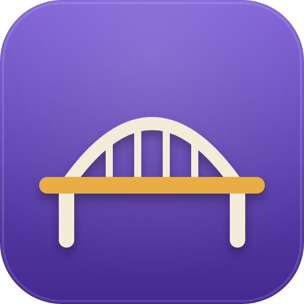
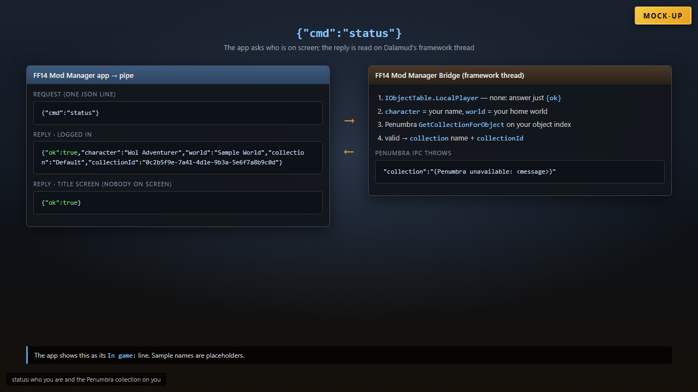
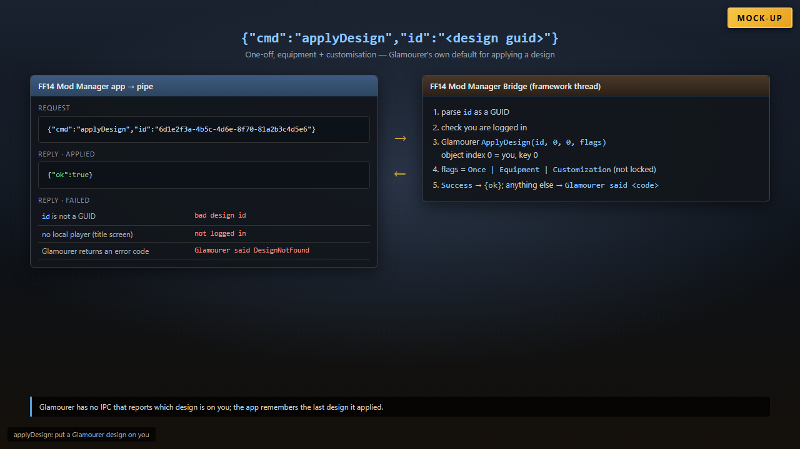
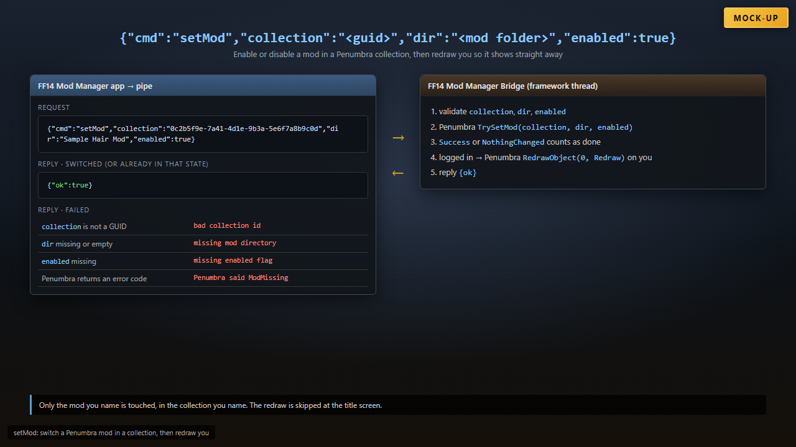
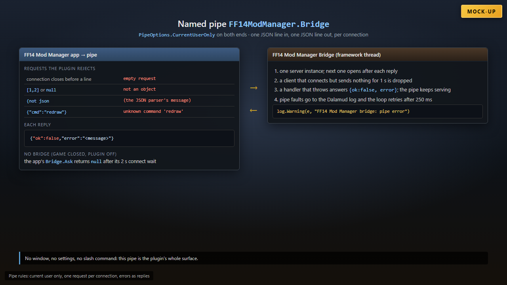

# FF14 Mod Manager Bridge



A Dalamud plugin that lets the **[FF14 Mod Manager](https://github.com/priestkos/ff14-mod-manager)** Windows app
see your character and apply Glamourer designs and Penumbra mods for you.

No commands · no window · Dalamud API 15 · .NET 10

> **No support will be provided. This software is to be used as is, without warranty of any kind.**

## Screenshots

These images are **mock-ups** (HTML rendered to PNG). They are not real in-game captures and do not show the actual
FFXIV client UI. The plugin draws no window, so each scene shows one exchange on its named pipe: what the app sends,
what the plugin does on the game's framework thread, and every reply it can give.

| | |
| --- | --- |
|  | **`status`** — your character, home world and the Penumbra collection on you; just `{"ok":true}` at the title screen. |
|  | **`applyDesign`** — Glamourer applies a design to you as a one-off (equipment + customisation), with the three error replies. |
|  | **`setMod`** — Penumbra enables or disables one mod in one collection, then redraws you; the four error replies. |
|  | **Pipe rules** — current-user-only pipe, one request per connection, bad requests answered as `{"ok":false,"error":…}`. |

### Mock-up video

A short **mock-up** walkthrough (not real gameplay) cross-fades through the same four exchanges with on-screen
captions. The gold **Mock-up** label stays visible for the whole clip.

- [mockup-walkthrough.mp4](docs/videos/mockup-walkthrough.mp4) (H.264, 1280×720, ~15 s)
- [mockup-walkthrough.gif](docs/videos/mockup-walkthrough.gif) (preview)

## What it does

The app works without it. With the Bridge running, the app can also:

- **Show who you are** — your character name, home world and the Penumbra collection on you (the app's
  "In game:" line at the top right).
- **Apply to my character** — put a Glamourer design on you, as a one-off with equipment and customisation, the way
  Glamourer itself applies a design by default.
- **Enable / Disable in collection** — switch one Penumbra mod on or off in one collection, then redraw you so the
  change shows straight away.
- **Remember the moment** — the app saves your character, world, collection and last applied design next to each
  screenshot it takes.

When the game is closed or the plugin is off, the app sees "no bridge" within its 2-second connect wait and carries on.

### What it is not meant to do

- **It does not act on its own.** Nothing happens until the app sends a request; the plugin has no timer, no hook and
  no reaction to game events.
- **It does not touch anyone else.** Designs are applied and redraws are done on object index 0 — you — only.
- **It does not change Penumbra beyond the one mod you name.** No collection is created, assigned or reordered, and no
  mod settings other than the on/off state are written.
- **It does not lock a design.** Glamourer applies it once; your next gear change or another Glamourer action replaces it.
- **It does not listen to the network.** The pipe is local and refuses any other Windows user.

## How it works

It opens a named pipe, `FF14ModManager.Bridge`, with `PipeOptions.CurrentUserOnly`, so only your own Windows user can
connect, and the app only trusts a server owned by that user. The app sends one JSON line and gets one back; then the
connection closes and the pipe waits for the next one.

| Request | Does | Reply |
| --- | --- | --- |
| `{"cmd":"status"}` | reads you and Penumbra's `GetCollectionForObject` for you | `{ok, character, world, collection, collectionId}`; just `{ok}` at the title screen |
| `{"cmd":"applyDesign","id":"<design guid>"}` | Glamourer `ApplyDesign(id, 0, 0, Once \| Equipment \| Customization)` | `{ok}` or `{ok:false, error}` |
| `{"cmd":"setMod","collection":"<guid>","dir":"<mod folder>","enabled":true}` | Penumbra `TrySetMod`, then `RedrawObject(0, Redraw)` if you are logged in | `{ok}` or `{ok:false, error}` |

Error replies the plugin sends, word for word:

| Case | `error` |
| --- | --- |
| `id` / `collection` is not a GUID | `bad design id` / `bad collection id` |
| `applyDesign` at the title screen | `not logged in` |
| `dir` missing or empty, `enabled` missing | `missing mod directory`, `missing enabled flag` |
| Glamourer or Penumbra returns a failure code | `Glamourer said <code>` / `Penumbra said <code>` (Penumbra's `NothingChanged` counts as success) |
| any other `cmd` | `unknown command '<cmd>'` |
| request is a JSON array or `null` / connection closed before a line | `not an object` / `empty request` |

If Penumbra's IPC throws during `status`, the reply still succeeds and `collection` reads
`(Penumbra unavailable: <message>)`.

Every game and IPC call runs on Dalamud's framework thread. A handler that throws answers `{ok:false, error}` instead
of crashing, and the pipe keeps serving. There is one pipe instance: a client that connects but sends nothing within
1 second is dropped so the next one is served. Pipe faults go to the Dalamud log as a warning
(`FF14 Mod Manager bridge: pipe error`), and the loop retries after 250 ms.

The protocol is in `FF14ModManagerBridge/Core/Bridge.cs`, and **the same file is in the app's repo**
(`App/Core/Bridge.cs`): change both together. On the app side, `Bridge.Ask` returns `null` — "no bridge" — when the
pipe is missing, times out, or answers with something that is not one JSON object (a bridge from another build).

## Commands

None. The plugin has no window, no settings, no configuration file and no slash command; it only answers the app.

## Build

Requires the .NET 10 SDK and the Dalamud dev distribution (`%APPDATA%\XIVLauncher\addon\Hooks\dev`).

```
dotnet build FF14ModManagerBridge/FF14ModManagerBridge.csproj -c Debug     # bin/Debug/FF14ModManagerBridge.dll
dotnet build FF14ModManagerBridge/FF14ModManagerBridge.csproj -c Release   # bin/Release/FF14ModManagerBridge/latest.zip
```

Both paths are under `FF14ModManagerBridge/`. CI builds the plugin and runs the pipe-protocol tests on every push.
Pushes to `main` that change the plugin (not docs-only paths ignored by the release workflow) run the tests again and
cut a GitHub release automatically. The version is the next four-part number above the latest release tag, or the
csproj version when that is higher.

## Install (dev plugin)

Released builds: add this custom plugin repository in Dalamud's plugin installer (`/xlsettings` → Experimental →
Custom Plugin Repositories), tick it, Save, then install **FF14 Mod Manager Bridge** from `/xlplugins`.

```
https://raw.githubusercontent.com/priestkos/PlogonYes/main/pluginmaster.json
```

Dev build:

1. `/xlsettings` → Experimental → Dev Plugin Locations → add `FF14ModManagerBridge/bin/Debug/FF14ModManagerBridge.dll`.
2. `/xlplugins` → Dev Tools → enable **FF14 Mod Manager Bridge**.
3. Start the FF14 Mod Manager app; its "In game:" line fills in once you are logged in.

Penumbra and Glamourer must be installed for the mod and design requests to work; `status` still reports your
character and world without them.

## Tests

The pipe protocol is Dalamud-free, so it is linked into a console harness and runs outside the game over a real named
pipe (with a random pipe name, so it never collides with a running plugin):

```
dotnet run --project FF14ModManagerBridge.Tests/FF14ModManagerBridge.Tests.csproj -c Release
# ALL PASS (12 checks)
```

Covers the round trip; a handler exception becoming `{ok:false, error}`; malformed JSON, a JSON array and a JSON `null`
rejected as errors; the server surviving an error, a client that hangs up silently, and a client that connects but never
writes; the client returning `null` for a non-object or broken reply; and `null` within the timeout when no server is
running. The exit code is the number of failed checks.

## Limits

- The Penumbra and Glamourer calls only run inside the game, so CI builds them but cannot exercise them; the in-game
  path is not covered by the tests.
- Glamourer has no IPC that says which design is on you; the app remembers the last design it applied.
- Applying a design uses Glamourer's defaults (equipment + customisation, one-off, not locked); there is no option to
  apply only gear or only appearance.
- One request at a time: a second app request waits for the pipe's single instance, up to the app's 2-second
  connect wait, and otherwise sees "no bridge".
- Without Penumbra, `status` still answers but carries no `collectionId`, or a `(Penumbra unavailable: …)` collection
  when the IPC call throws (not verified in game).

## Layout

```
FF14ModManagerBridge/Plugin.cs           services, pipe server start/stop, the three commands
FF14ModManagerBridge/Core/Bridge.cs      pipe protocol (server loop + client Ask), shared with the app
FF14ModManagerBridge.Tests/Program.cs    offline real-pipe harness
images/                                  icon.svg (source) and icon.png (manifest icon)
docs/screenshots/, docs/videos/          mock-up PNGs and walkthrough video
.github/workflows/                       build.yml (build + tests on every push), release.yml (tests + release on main)
```

Built against Penumbra.Api 5.19.2 and Glamourer.Api 2.8.2 (both MIT).
